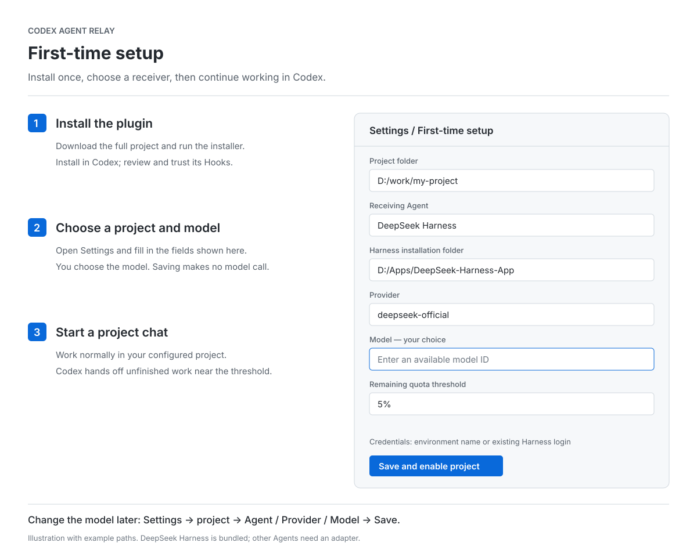

# Codex Agent Relay

[简体中文](README.zh-CN.md) · [First-time setup](#first-time-setup) · [Security](docs/security.md) · [Verification](docs/verification.md)

[](https://github.com/chengweiziji/codex-agent-relay/actions/workflows/ci.yml)

When Codex is close to its usage limit and your task is unfinished, it prepares a checkpoint and can hand the remaining work to another Agent on your computer. You choose the receiving Agent and model. Progress and the final answer appear in a local dashboard. Opening it automatically in the same Codex window remains an unverified desktop integration step.

Once a project is approved, Hooks track execution tasks and prompt Codex to finish or prepare a checkpoint near the quota threshold. The bundled DeepSeek Harness adapter can take over the remaining work in a **workspace-write** sandbox: writes are confined to the project, and the actual provider/model plus sandbox mode are attested from the first request, stopping the receiver on any mismatch. Reads, network access and process visibility are not isolated, and operations that need interactive approval fail closed.

**Status:** v0.1.0 preview. **License:** MIT. **Bundled adapter:** DeepSeek Harness (real dispatch with route/sandbox attestation; Windows ACL preflight). Qoder CN and ZCode are not integrated yet. **Local prerequisite:** `gitleaks` or a reviewed scanner configured in `user.json`; handoff fails closed without one.

**Latest acceptance (2026-10-30):** With simulated 4% quota, the user reported a successful model-initiated, approved handoff and a visible right-panel result. Independent checks confirmed the receiver ended, fixed the fixture, preserved its test hash, and passed the test. This does not establish unattended approval or a real account threshold crossing. See the latest section of [verification](docs/verification.md).

## What happens in a chat

1. Codex works on your task and saves checkpoints.
2. At **5% or less remaining quota**, a tool-boundary hook asks Codex to finish or hand off. You can change the threshold.
3. If work remains, Codex saves the progress, remaining steps, changed files, tests and running-process identifiers, then calls the handoff tool. The bundled DeepSeek Harness adapter starts the receiver after a local permission preflight; a custom adapter must provide its own preflight and isolation.
4. The chat shows the selected Agent, model, receipt and any user-recorded evidence. Codex stops source execution only after a successful dispatch.
5. The receiver continues in the project directory. The local panel shows activity, the final answer and recorded evidence. Use **Save .md** to export the result. File changes stay in the project.

The panel updates without further Codex inference. It does not insert new model-generated messages into an exhausted Codex chat. A receiver saying “complete” is shown separately from evidence you record yourself; the relay does not execute acceptance commands or certify a pass.

## Requirements

- Node.js **24+**, available as `node` in the terminal and Codex environment.
- Codex desktop or CLI with plugin Hooks and `account/rateLimits/read`. The right panel requires desktop.
- Local DeepSeek Harness with the standard `sdk` profile, an available model and working provider credentials.
- `gitleaks` on the service `PATH`, or a reviewed scanner configured under `scanner` in `user.json`. A missing, failing or timed-out scanner blocks handoff.

Download the **whole project**. The skill, Hooks, MCP tools and service work together; copying `SKILL.md` alone cannot start background monitoring. No npm install is needed to run the relay.

## First-time setup



*Illustration with example paths, not evidence of a completed handoff.*

### 1. Install the plugin

[Download ZIP](https://github.com/chengweiziji/codex-agent-relay/archive/refs/heads/main.zip) and open a terminal in the extracted folder, or clone:

```sh
git clone https://github.com/chengweiziji/codex-agent-relay.git
cd codex-agent-relay
```

Prepare a **new** installation directory and add its local marketplace. These commands work in PowerShell and common Unix shells:

```sh
node scripts/install-local.ts --destination "$HOME/.local/share/codex-agent-relay"
codex plugin marketplace add "$HOME/.local/share/codex-agent-relay"
```

The installer prepares executable paths. It does not edit global Codex settings or enable existing projects. In Codex **Plugins**, select the local **Codex Agent Relay** source and install. Review and trust its Hooks using `/hooks` or the host review UI. Start a new chat if the host requires one to load tools. Trust is a Codex requirement; the skill cannot bypass it. [Official Hooks documentation](https://learn.chatgpt.com/docs/hooks)

### 2. Choose the project and model

Use the plugin's **Setup** action, ask Codex to “open Agent Relay settings,” or run:

```sh
node "$HOME/.local/share/codex-agent-relay/src/cli.ts" setup
```

Open the local URL it prints. Fill in:

| Setting | What to enter |
|---|---|
| Project folder | The project Codex is working in |
| Receiving Agent | DeepSeek Harness; other Agents need an adapter |
| Harness location | Its installation folder, package folder, or `@deepseek-ai/dsh/lib/bin.js` |
| Provider | Your configured provider, for example `deepseek-official` |
| Model | **Your choice**, using an available model ID from that provider |
| Threshold | Default `5`, meaning 5% remaining |
| Credentials | Environment variable **name**, e.g. `DEEPSEEK_API_KEY`; leave blank for Harness's existing credential setup |

Click **Save and enable** and confirm the data-disclosure dialog. This writes local configuration, without starting a task or calling a model. You can configure a project before its first task; no JSON editing is needed. On Windows, choose a project folder that grants your own account full control (for example under your user profile); the first handoff refuses to start if that permission is missing, and it never edits permissions automatically.

Do not enter an API key into the page. Set credential environment variables before starting the local service. Restart it after changing that environment. Existing Harness launch preferences are preserved.

### 3. Start a project chat

Start an execution task in the configured project. Trusted Hooks prompt Codex to register it and maintain checkpoints. For the first chat, you can explicitly invoke `$codex-agent-relay` and confirm the task appears in the panel. Once registered, the hook supplies the handoff instruction at the threshold; you do not need to watch the quota yourself.

Completed work, Plan mode, paused tasks and tasks waiting for your decision are excluded. Once a handoff is accepted, the receiver owns the workspace: source tool calls are denied until its result is reviewed. The relay never auto-approves: a receiver approval event stops the run and marks it failed; it cannot be reported as completed. Codex may separately require approval before invoking relay_handoff.

## Change the Agent or model

Open **Settings → project → Agent / Provider / Model → Save**, or ask Codex to open settings. Changes apply to the **next handoff**. Running receivers keep their original configuration.

The model is not preselected and has no silent fallback. Installed adapters appear in the Agent selector; [the adapter interface](docs/adapters.md) explains how to add one. Entering an Agent name alone does not implement its integration.

CLI users can run:

```sh
node src/cli.ts configure --project /path/to/project --model YOUR_MODEL_ID --approve
node src/cli.ts dashboard
node src/cli.ts status
```

## Verified behavior and limits

- **73 tests, all passing locally on Windows with a local Gitleaks binary** (69 pass and the 4 real-scanner tests skip without `RELAY_TEST_GITLEAKS`), including installed Hooks/MCP, quota thresholds, duplicate dispatch, project isolation, setup, execution after source MCP exit, environment allowlisting, project-trust fingerprints, persisted-state omission, evidence-only verification, retention, scanner blocking and process-tree stop. Includes real Gitleaks bypass regressions, route/sandbox attestation failures and the Windows ACL preflight. Type checking passed. [Tested versions and evidence](docs/verification.md)
- **Historical real smoke on the previous build (before the 2026-10-30 review fixes):** the opt-in smoke dispatched a disposable two-file project to `deepseek-official/deepseek-v4-flash`, attested `workspace-write` and `ask`, changed `sum.cjs`, and ended with `reportedComplete: true`; an independent `node test.cjs` printed `SMOKE_TEST_PASSED`. Completion is self-reported: inspect the files and tests yourself before treating work as accepted.
- The local acceptance plugin's seven Hooks were listed as trusted by a real Codex 0.166 app-server thread. Execution was observed for SessionStart, UserPromptSubmit, PreToolUse, PostToolUse and Stop; execution of Interrupt and SessionEnd was not established. In a real model turn the model itself called `relay_register` and `relay_checkpoint`; Codex then blocked its `relay_handoff` call pending approval for the destructive tool, so no receiver task was created. The same task was then given a fresh checkpoint and handed off through the authenticated relay API (no extra Codex model quota) to the real receiver: route `deepseek-official`/`deepseek-v4-flash`, `workspace-write` and `ask` were attested, only `sum.cjs` changed, `reportedComplete: true`, and an independent `node test.cjs` printed `HOST_TEST_PASSED`. Fully automatic user-approved handoff and right-panel opening remain unverified. Cross-platform CI is supplied; actual runs appear in this repository's Actions tab.
- A long request can consume the reserve before a hook runs. Unknown or exhausted quota retains the checkpoint and does not fabricate a handoff.
- The receiver's sandbox confines **writes and deletes** to the project (plus its private temp directory). It does not restrict reads, network access or process visibility, and it is not a virtual machine. The relay never auto-approves escalations; observed approval events fail the run pending user review. A custom adapter is trusted code and must implement its own isolation and route verification.

Try a disposable project first. The demo uses **simulated quota and a simulated Agent**, needs no credentials, and prints a local panel URL:

```sh
node scripts/demo.ts
```

## Development

For the four real-scanner tests, run `node scripts/install-test-scanner.ts` and set `RELAY_TEST_GITLEAKS` to the executable path it prints. They are explicitly skipped locally when unset; CI provisions and requires them. Projects containing a root `.gitleaksignore` fail closed because Gitleaks still merges that file despite explicit ignore-path options.

```sh
pnpm install --frozen-lockfile
pnpm check
pnpm test
node scripts/docs-figures.ts
node scripts/package.ts
```

The release uses an explicit file list. Credentials, real task history, local installations and logs are excluded. `dist/` contains the archive, manifest and SHA-256 checksum.

The optional real smoke test is opt-in: `scripts/smoke-real.ts` does nothing unless `RELAY_SMOKE_REAL=1`. With that set, it requires explicit `RELAY_SMOKE_PROVIDER` and `RELAY_SMOKE_MODEL`, a Harness launch (`RELAY_SMOKE_DSH` or `agents.deepseek-harness` in `user.json`), `DEEPSEEK_API_KEY` (or `RELAY_SMOKE_CREDENTIAL`) and a local scanner. It uses a disposable project under your user profile and simulated quota, and spends real provider credits. Current real-run evidence is recorded in [verification](docs/verification.md).

## Disable or uninstall

Uncheck **Enable relay** in settings to prevent future handoffs. Stop active receivers from the progress page and inspect separately launched background jobs. Disabling a project does not cancel its running receiver or remove its ownership guard. Editing a launch, adapter module or scanner in `user.json` revokes the project approval; save the settings page again to approve the new launch.

Disable/uninstall the plugin and remove its marketplace source in Codex. Stop the specific service recorded in the relay home's `server.json`, or use Ctrl+C for a foreground server. Checkpoints and project changes are retained unless you deliberately delete them; local job content expires after `retentionDays` (default 7). [Configuration and recovery](docs/configuration.md) · [Security and data handling](docs/security.md)

GitHub distribution is separate from OpenAI's public plugin directory, which currently excludes lifecycle Hooks. This project provides source for local installation. [Official packaging documentation](https://developers.openai.com/plugins/build/plugins)
