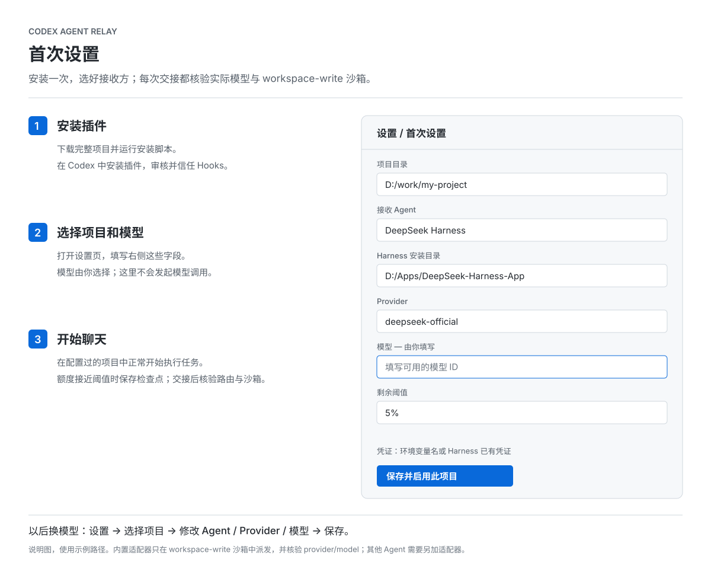

# Codex Agent Relay

[English](README.md) · [首次设置](#首次设置) · [安全说明](docs/security.md) · [验证记录](docs/verification.md)

[](https://github.com/chengweiziji/codex-agent-relay/actions/workflows/ci.yml)

Codex 额度快用完、任务还没做完时，先整理检查点，再把剩余工作交给电脑上的另一个 Agent。接收 Agent 和模型由你选择，执行过程和最终答复显示在同一 Codex 窗口右侧。

项目获准后，Hooks 会跟踪执行任务，并在接近额度阈值时提醒 Codex 完成或保存检查点。**本预览版有意禁用真实自动派发：**随附的 DeepSeek Harness 传输层还不能验证接收方隔离和实际 provider/model。模拟演示和经过审核的自定义适配器可以走完整交接流程。

**版本：**v0.1.0 预览版。**许可证：**MIT。**当前适配器：**DeepSeek Harness（仅传输层，派发已禁用）。Qoder CN、ZCode 暂未接入。**本机前置条件：**`gitleaks`，或在 `user.json` 中配置经过审核的扫描器；没有可用扫描器时交接会失败关闭。

## 在一个聊天里会发生什么

1. Codex 正常完成任务，并保存进度检查点。
2. 适用于当前任务的额度窗口剩余 **≤5%** 时，Hooks 在工具调用边界提醒 Codex。阈值可以修改。
3. 如果还有剩余工作，Codex 整理进度、后续步骤、修改文件、测试证据和运行中进程，再调用交接工具。随附适配器目前会拒绝真实派发；需要经过审核的自定义适配器完成传输。
4. 聊天显示接收 Agent、模型、接收回执和用户记录的证据。只有派发成功后，Codex 才停止执行源任务工具。
5. 接收 Agent 在项目目录继续工作。右侧显示过程、最终答复和已记录证据；可以点 **保存结果 / Save .md** 导出。代码及其他文件直接保留在项目里。

后续页面更新不需要 Codex 继续推理。最终结果保留在右侧，不会伪装成额度耗尽后 Codex 又生成了一条回复。“Agent 自报完成”与用户自行记录的证据分开显示；Relay 不执行验收命令，也不自动判定通过。

## 安装前准备

- **Node.js 24+**，终端和 Codex 环境中可以使用 `node`。
- 支持插件 Hooks 和 `account/rateLimits/read` 的 Codex 桌面版或 CLI。右侧页面需要桌面版。
- 本机 DeepSeek Harness 支持标准 `sdk` profile，并有可用模型和 provider 凭证。
- 服务 `PATH` 中有 `gitleaks`，或在 `user.json` 的 `scanner` 中配置经过审核的扫描器。缺失、失败或超时都会阻止交接。

请下载**完整项目**。Skill、Hooks、MCP 工具和本地服务需要一起工作；只复制 `SKILL.md` 不会产生后台额度监控。运行本项目不需要先执行 npm install。

## 首次设置



*图中使用示例路径，是设置说明图，不代表真实任务已成功交接。*

### 1. 下载并安装

[下载 ZIP](https://github.com/chengweiziji/codex-agent-relay/archive/refs/heads/main.zip)，解压后在该目录打开终端。也可以使用 Git：

```sh
git clone https://github.com/chengweiziji/codex-agent-relay.git
cd codex-agent-relay
```

创建**新的**本机安装目录并添加插件来源。下面的命令可用于 PowerShell 和常见 Unix shell：

```sh
node scripts/install-local.ts --destination "$HOME/.local/share/codex-agent-relay"
codex plugin marketplace add "$HOME/.local/share/codex-agent-relay"
```

脚本会生成本机启动路径，不会修改全局 Codex 配置，也不会启用已有项目。在 Codex **插件**页面选择本地 **Codex Agent Relay** 来源并安装。在 `/hooks` 或客户端审核入口检查并信任 Hooks。若客户端要求，重新开始一个聊天以加载工具。信任 Hooks 是 Codex 的要求，这个 Skill 不能跳过。[官方说明](https://learn.chatgpt.com/docs/hooks)

### 2. 打开设置页，选择接收方

使用插件的 **Setup / 设置**入口，在 Codex 中说“打开 Agent Relay 设置”，或者执行：

```sh
node "$HOME/.local/share/codex-agent-relay/src/cli.ts" setup
```

打开命令输出的本地链接，填写以下内容：

| 设置 | 填写内容 |
|---|---|
| 项目目录 | Codex 正在处理的项目 |
| 接收 Agent | DeepSeek Harness；其他 Agent 需要先添加适配器 |
| Harness 位置 | 安装目录、包目录，或 `@deepseek-ai/dsh/lib/bin.js` 文件 |
| Provider | Harness 中配置的 provider，例如 `deepseek-official` |
| 模型 | **由你填写**，使用该 provider 实际支持的模型 ID |
| 剩余阈值 | 默认 `5`，表示剩余 5% |
| 凭证 | API Key 的**环境变量名**，例如 `DEEPSEEK_API_KEY`；留空则使用 Harness 已有凭证配置 |

点击 **保存并启用此项目**，并在弹窗中确认数据披露。页面写入项目配置和本机启动配置，不会立即启动任务或调用模型。不需要先登记任务，也不需要手改 JSON。保存后，随附适配器仍会拒绝真实派发。

不要把 API Key 填进网页。使用环境变量时，应在启动本地服务前设置；修改环境后需要重启服务。本机已有的 Harness 启动偏好会保留。

### 3. 在 Codex 中正常工作

在该项目里开始执行任务。已信任的 Hooks 会提示 Codex 自动登记任务并维护检查点。第一次可以显式调用 `$codex-agent-relay`，确认页面里出现该任务。登记后，Hooks 会在达到阈值时给出交接指令，不需要一直盯着额度。

已完成、计划模式、暂停以及等待用户决策的任务不会自动交接。使用随附适配器发起交接会得到明确的“派发已禁用”错误；这是能力限制，不代表交接成功。可以用 `node scripts/demo.ts` 或安装经过审核的适配器走完整事件流程。

## 以后怎么换 Agent 或模型

打开 **设置 → 选择项目 → Agent / Provider / 模型 → 保存**，也可以直接让 Codex 打开设置页。修改从**下一次交接**生效；正在执行的接收方保持启动时的配置。

模型字段不预选，选择权留给用户。模型不可用时会报错，不会暗中换模型。添加了适配器的 Agent 会出现在选择列表中，接口见 [适配器文档](docs/adapters.md)。仅填写某个 Agent 的名字不能让程序自动获得对它的支持。

习惯命令行的话，也可以使用：

```sh
node src/cli.ts configure --project /path/to/project --model YOUR_MODEL_ID --approve
node src/cli.ts dashboard
node src/cli.ts status
```

## 当前验证情况与限制

- **Windows 本地 59 项测试通过**，覆盖安装后的 Hooks/MCP、额度阈值、重复交接、项目隔离、首次设置、源 MCP 退出后继续执行，以及环境变量白名单、项目信任指纹、持久化脱敏、仅记录证据、保留期限、扫描器失败和进程树终止。新增真实 Gitleaks 绕过、扫描期间内容变更、空闲清理和设置串项目的回归测试。类型检查通过。[版本与证据](docs/verification.md)
- **历史记录：**较早构建上的一次真实 Harness 测试已接收任务、修改隔离项目，独立复验通过；其内部 shell 测试被 Windows 沙箱初始化拦截。该记录不代表当前能力：随附适配器现在会在启动接收方之前拒绝派发。
- 完整的“客户端安装并信任 Hooks 后自动触发”流程仍需宿主侧验收。已提供跨平台 CI，实际运行结果以仓库 Actions 页面为准。
- 一次较长请求可能直接跨过阈值耗尽额度。额度未知或已经耗尽时保留检查点，不宣称交接成功。
- 接收方仍遵守自己的权限与沙箱，不会自动批准操作或关闭保护。自定义适配器属于受信代码，必须自行实现隔离和路由核验。

建议先在临时项目验证。演示使用**模拟 Agent 和模拟额度**，无需密钥，会输出本地进度页地址：

```sh
node scripts/demo.ts
```

## 开发与打包

4 项真实扫描测试需要先运行 `node scripts/install-test-scanner.ts`，再将 `RELAY_TEST_GITLEAKS` 设置为输出的可执行文件路径。本机未设置时会明确跳过，CI 会安装校验过的版本并强制运行。项目根目录存在 `.gitleaksignore` 时交接会被拒绝：Gitleaks 即使指定忽略文件路径仍会合并此文件，Relay 不会擅自修改项目文件。

```sh
pnpm install --frozen-lockfile
pnpm check
pnpm test
node scripts/docs-figures.ts
node scripts/package.ts
```

打包使用明确的文件清单。密钥、真实任务内容、本机安装副本和日志不进入发布包。`dist/` 包含源码包、逐文件清单和 SHA-256 校验值。

可选真实测试在本预览版中已禁用：`scripts/smoke-real.ts` 会在启动接收方或调用 provider 之前直接报错。历史真实测试证据保留在[验证记录](docs/verification.md)中。只有实现并审核了具备隔离和实际 provider/model 证明的适配器后才应重新启用。

## 关闭或卸载

在设置里取消 **启用 Relay**，可阻止后续交接。运行中的接收任务需要在进度页单独停止，并检查其启动的后台进程。关闭项目开关不会取消运行中的接收方，也不会直接撤销目录保护。编辑 `user.json` 中的启动命令、适配器模块或扫描器会撤销项目批准；需要重新打开设置页保存一次。

在 Codex 停用或卸载插件，并移除来源。停止本地数据目录 `server.json` 记录的对应服务进程；前台运行可用 Ctrl+C。检查点和项目改动默认保留；本地任务内容按 `retentionDays`（默认 7 天）过期。[配置与恢复](docs/configuration.md) · [安全说明](docs/security.md)

GitHub 开源与 OpenAI 公共插件目录是不同的分发方式；后者目前不接收含生命周期 Hooks 的插件。本项目提供源码供本地安装。[官方打包说明](https://developers.openai.com/plugins/build/plugins)
